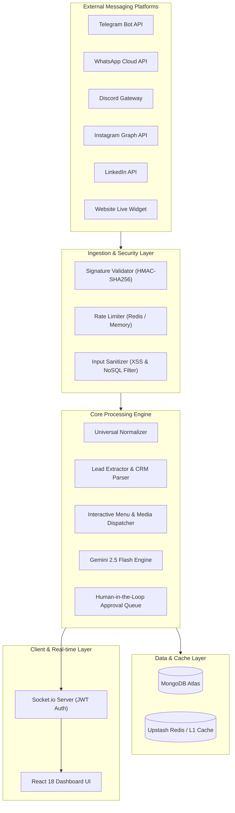
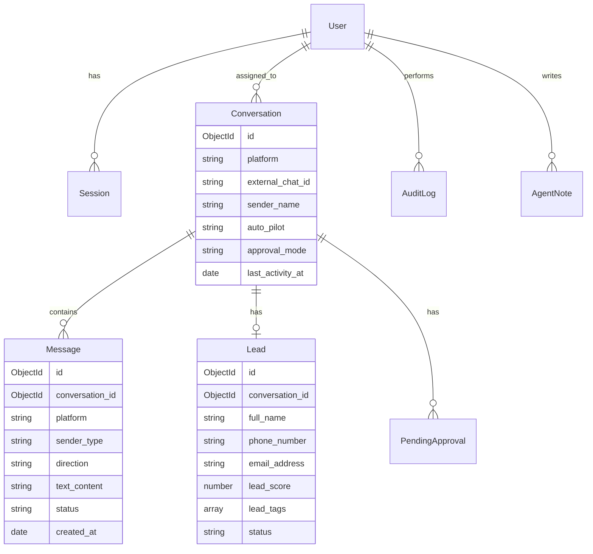

# OmniHub System Architecture & Technical Design 🏛️

## 1. High-Level Architectural Diagram

---

## 2. Universal Ingestion Pipeline

1. **Webhook Ingestion**:
   Incoming payload arrives at `/api/webhooks/:platform`.
2. **Signature & Rate Limiting**:
   - Meta platforms (WhatsApp/Instagram) are verified using `X-Hub-Signature-256` HMAC-SHA256.
   - Telegram verifies secret token header.
   - Rate limits enforce 1,000 req/min per channel.
3. **Data Normalization (Universal Schema)**:
   Payload is transformed into unified schema:
   - `platform`: `telegram` | `whatsapp` | `discord` | `instagram` | `linkedin` | `webchat`
   - `external_chat_id`: Platform-specific identifier
   - `sender_name`, `sender_phone`, `sender_email`
   - `message_type`: `TEXT` | `BUTTON_CLICK` | `MEDIA` | `VOICE`
   - `text_content`, `media_url`, `button_payload`
   - `timestamp`: UTC ISO-8601
4. **Conversation Lookup & Inbound Message Persistence**:
   - Atomic upsert on `Conversation` with compound index `{ platform: 1, external_chat_id: 1 }`.
   - Message saved with direction `INBOUND`.
5. **Real-time Broadcast**:
   - Dispatches `new_message` event to connected dashboard agents via Socket.io.
6. **Lead Extraction & Intent Scoring**:
   - RegEx pattern parser extracts phone numbers and emails.
   - High-intent keywords (`price`, `quote`, `enterprise`) automatically assign `#HOT_LEAD`, `#PRICING_INQUIRY`, `#VIP` and compute lead score.
7. **Automation Decision Tree**:
   - **Check Auto-Pilot**: If `auto_pilot === 'OFF'`, automation halts; conversation is flagged for human agent takeover.
   - **Check Button Clicks**: If message is a button click, `menuService` resolves submenus or brochures.
   - **Check Approval Mode**:
     - If `approval_mode === 'AUTO'`: Gemini generates reply and dispatches immediately.
     - If `approval_mode === 'MANUAL'`: Draft is placed in `PendingApproval` queue and held until client review.

---

## 3. Database Schema Architecture

---

## 4. Security Hardening Specifications

1. **Helmet Headers**: Content-Security-Policy, Strict-Transport-Security, X-Frame-Options (`DENY`), X-Content-Type-Options (`nosniff`).
2. **CORS Policy**: Restricts cross-origin requests to configured client origin and pre-approved origins.
3. **NoSQL & XSS Sanitization**: Strips `$` keys from incoming JSON bodies to prevent MongoDB query injection; sanitizes HTML script tags.
4. **JWT Security**: Access tokens expire in 15 minutes; Refresh tokens are rotated upon each renewal.
5. **Audit Trail**: Sensitive actions (Logins, Role changes, Session revocations, Password updates) are logged into the `AuditLog` collection with timestamp, IP, and user context.

